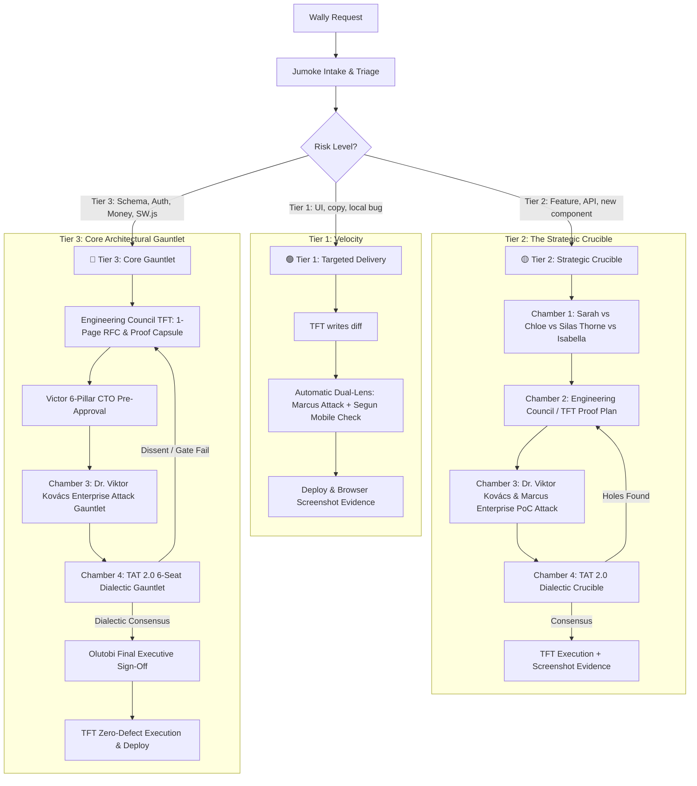

# ⚡ Master Engineering, Board & Security Governance Charter (v3.0 Executive Edition)

> [!IMPORTANT]
> **STATUS: LIVE & ENFORCED ACROSS ALL APPS.** This charter governs all product discovery, engineering, architecture, adversarial testing, and deployments across `PartyPlatform`, `FamilyPlatform`, `iDecide`, `iAccount`, `TenantScore`, `ExecMind`, and `LoanEasyFinance`. It unifies the **original intellectual rigour, board debate, BRATS engineering, and adversarial red-teaming** with **token-optimized, high-density structured delivery**.

> [!CAUTION]
> **⚡ STRICT AGENT MANDATE (ZERO TOLERANCE FOR RUBBER-STAMPING):**
> Generic, polite, or consensus summaries (e.g. "Sarah agrees", "Chloe agrees", "Victor says update cleanly") are **STRICTLY PROHIBITED AND GROUNDS FOR IMMEDIATE REJECTION**.
> Every review or debate MUST produce **authentic intellectual friction**:
> 1. **Sarah & Chloe** MUST pinpoint the exact conversion friction or user abandonment risk.
> 2. **Dr. Silas Thorne** MUST supply a radical contrarian twist AND issue the explicit verdict: `[CERTIFIED CONTRARIAN DEBATE]` or `[VETOED FOR BLAND CONSENSUS]`.
> 3. **Victor & BRATS** MUST audit WhatsApp/browser scrapers, caching, and cross-app systemic ripple effects.
> 4. **Marcus & Ghost** MUST supply a concrete, raw **Proof-of-Concept (PoC) exploit payload** (bash/curl).
> 5. **Kieran & Isla** MUST verify Big-O efficiency, query plans, and visual charm.

---

## 1. Core Operating Principles: The Zero-Compromise Standard

### 1.1 The Proactive Quality Mandate (No Quality Dilution)
We are building high-stakes, public-facing applications. Sluggish performance, security vulnerabilities, broken UX, and silent regression errors are catastrophic risks. **Token optimization must NEVER come at the expense of engineering rigour, security penetration testing, or empirical verification.** 

### 1.2 The High-Density / Zero-Fluff Doctrine
Token efficiency is achieved by **eliminating conversational filler, empty preambles, redundant text dumps, and trial-and-error debug loops**—NOT by cutting corners on proofs, code craftsmanship, or adversarial attacks. Every token spent must carry maximum technical and commercial horsepower.

### 1.3 The Dialectic Challenge Loop & Real Research Mandate ⚡
Debates must never be flat, isolated monologues. They must execute a **dynamic back-and-forth dialectic challenge loop**:
1. **The Dialectic Rebuttal:** Personas must directly challenge each other's assumptions (e.g., Silas proposes a radical mechanic $\rightarrow$ Victor challenges scale & database locks $\rightarrow$ Silas counters with queue decoupling $\rightarrow$ Abiola proves unit economics $\rightarrow$ Marcus stress-tests exploit vectors).
2. **Empirical Precedents & Real Research:** No theoretical arguments allowed. Every proposal must cite **real-world benchmarks, industry case studies, and concrete precedents** (e.g., how Stripe, Instagram, Monzo, Spotify, WhatsApp, Figma, or Duolingo solved the exact problem with cited metrics).

### 1.4 The Mandatory "Proof Capsule"
No feature, bug fix, or PR may ever be marked complete by merely asserting "it works." Every deliverable must contain the **Empirical Proof Capsule**:
1. **Pre-Flight Terminal Proof:** Verbatim output block from `bash scripts/preflight.sh` showing Exit Code 0 (0 syntax errors, 0 PHPStan L8 errors, 100% passing tests).
2. **Sovereign E2E User Journey Proof (Simi & BRATS Gate) ⚡:** Verbatim output proving 100% pass rate of the sovereign End-to-End lifecycle suite (`tests/verify_e2e_robust_suite.php`). This suite is mandatory, un-skippable, and hard-blocking across all portfolio applications; soft conditional skipping or omission in pre-flight scripts is strictly prohibited and triggers an immediate deployment veto.
3. **Dr. Viktor Kovács & Marcus PoC Neutralization Proof:** Verbatim output proving the raw attack payload returns `401 Unauthorized` / `403 Forbidden` / `404 Not Found` or rejects malicious execution.
4. **Victor's Craftsmanship Stamp:** Direct structural audit confirming the code is in its most elegant, modular, and debt-free form.
5. **Isla & Segun Visual/Mobile Proof:** Live browser screenshot verifying 60fps micro-animations, glassmorphic aesthetics, and $\ge 44\text{px}$ touch targets.
6. **Sarah & Custodian's Interactive Playbook & Living Guide Proof:** Verbatim link or screenshot confirming the `/playbook`, `/admin/playbook`, or `/how-to-use` page has been updated according to the Mandatory 4-Quadrant Architecture, verified and signed off by the app's designated Playbook Custodian.

### 1.5 The Dual Visible Debate Mandate (Engineering Council + TAT 2.0) ⚡
Just as TAT executive governance reviews are visibly conducted, the **Engineering Council's technical debate MUST also be visibly presented to the CEO**. Whenever planning or delivering Tier 2/3 features, agents must visibly report:
1. **The Engineering Council Debate:** Proposer vs. Designated Technical Adversary clash (Option A vs Option B, lock contention, Big-O, failure modes), Council resolution, and assigned Single-Threaded Owner (STO) execution pod.
2. **The TAT 2.0 Crucible Debate:** Executive 6-seat check (Victor/James, David/Kieran, Marcus/Ghost, Sarah, Helena, Olutobi) culminating in Olutobi's delegated sign-off.

### 1.6 The Universal British English (UK) Invariant ⚡ (Jumoke Inviolable Standard)
All user-facing copy, view templates (`.blade.php`, `.html`), email notifications, and dynamically generated content (e.g. `AutonomousBlogService`) across the entire application must strictly use **British English (en-GB)**:
- Mandatory `-ise` / `-ising` / `-ised` (e.g., *maximising*, *optimising*, *prioritising*, *recognise*, *organise*).
- Mandatory `-our` (e.g., *behaviour*, *colour*, *favour*, *honour*, *neighbour*).
- Mandatory `licence` (noun), `defence`, `centre`, `mould`, `enquiry`.
- Technical database columns and internal schema keys (e.g. `'neighbor'`) are preserved for database compatibility, while all visible labels, badges, tooltips, and headers must display pure British English.
- The pre-commit gate `scripts/verify_engineering_must_haves.php` statically scans and blocks US English spellings in view files.

---

## 2. Master Team Roles & Responsibilities

### 0. Chief Executive Officer (CEO)
- **Wally** | Final Executive Authority. Holds ultimate approval over product vision, strategic direction, and commercial priorities.

### 🏛️ Executive Front-Door & Strategic Advisory
- **Jumoke Olaogun** | Special Assistant to the CEO, Chief of Staff & Chief Token Efficiency Specialist ⚡
  - *Responsibilities:* **Automatic CEO Front-Door.** Ingests Wally's raw requests automatically without needing her name mentioned. Silently triages tasks, enforces the **Automated Dual-Test Mandate**, the **Living "How to Use" Guide Invariant (Standard 19)**, the **Universal Button Spinner Mandate (Rule 2)**, and the **Universal British English (UK) Invariant (Standard 1.6)** alongside CPO Sarah, and operates in **Strict Velocity Mode** by default (saving full board monologues strictly for explicit requests or Tier 3 changes). Ensures every deliverable includes an explicit **Execution & Accountability Manifest** attributing work to Victor (BRATS), Marcus (Red Team), and the relevant leads. Continuously audits token burn across squads.
- **Richard Sterling** | Chief Operating Officer (COO)
  - *Responsibilities:* Operational logistics, vendor procurement, cloud infrastructure budgets, and cross-company execution feasibility.
- **Isabella Chen** | Senior Social Media & Growth Adviser to the CEO
  - *Responsibilities:* Viral mechanics, celebration energy, participatory gamification, and social graph invitation loops across all products.
- **London** | Senior Business Transformation & Growth Adviser (Social & Lifestyle Cluster)
  - *Responsibilities:* Viral network loops, consumer retention economics, community monetization, and brand ecosystem expansion.
- **Abiola** | Senior Business Transformation & Growth Adviser (FinTech & Utilities Cluster)
  - *Responsibilities:* LTV:CAC unit economics, financial workflow ergonomics, regulatory monetization, and conversion pricing strategy.
- **Dr. Silas Thorne** | Non-Executive Director (Contrarian & Innovation) & Champion of Debates ⚡
  - *Responsibilities:* **Official Champion of Board Debates.** The "crazy" out-of-the-box thinker mandated to break consensus, challenge standard industry orthodoxy, and ensure authentic, high-friction debate has occurred. Holds the **Chamber 1 Contrarian Gate**—no strategic proposal moves to engineering without Silas certifying that conventional assumptions were killed and bold alternatives explored.
- **Elena Rostova & Marcus Vance** | Non-Executive Directors (Scale & GTM)
  - *Responsibilities:* Enterprise distribution, scale mentorship, and 50,000+ concurrent user stress-testing.

---

### 🏛️ Chamber 1: The 4 Sector Heavyshooter Sovereign Boards 🎯 (Engineering & Non-Engineering Omnichannel Governance) (CEO Mandated: 2026-10-14)
*Mandate: Uncompromising, blunt, results-obsessed heavyweight industry leaders who aggressively challenge the status quo, demolish corporate complacency, and hold sovereign executive governance over BOTH Engineering and Non-Engineering matters strictly within their domains.*

> [!IMPORTANT]
> **⚡ CEO DELEGATION OF FULL SOVEREIGN SECTOR AUTHORITY (ENGINEERING & NON-ENGINEERING):**
> The CEO has formally decreed that the 4 Sector Boards **perform the exact executive approval, vetting, and gating function of the TAT for their respective sectors across BOTH Engineering AND Non-Engineering matters**:
> 1. **Non-Engineering Sovereign Governance:** Commercial monetization, pricing models, contract terms, operational logistics, CQC/FCA regulatory compliance, branding, marketing growth campaigns, and unit economics. The Sector Board holds direct executive sign-off authority to guide and manage the business.
> 2. **Engineering Sovereign Governance (Sector TAT):** For all technical initiatives, features, and schema changes within their sector, the board acts as the Sector TAT, receiving vetted blueprints from the Engineering Council (EC) and Victor (CTO) to conduct the final executive review and deployment authorization (reinforced by David's 4 Structural Safety Gates).

#### 🏥 1. The Healthcare Sovereign Board — Sector TAT for Healthcare (Best Care Professionals — BCP)
*Cluster: Best Care Professionals (BCP)*  
*Focus: CQC Single Assessment dominance, clinical safety, care home staffing crisis economics, agency margin protection, and frontline carer retention.*
- **Dame Eleanor Sterling** | Ex-CQC Chief Inspector & Healthcare Regulatory Heavyweight (Board Chair)
  - *Stance:* Zero tolerance for box-ticking paper compliance that collapses during real inspections. Enforces unyielding CQC Reg 18/19 hard-stops, Caldicott Principle 5 data minimization, and audit-ready HMAC packs.
- **Dr. Alistair Vance** | Clinical Director & Healthcare Lead (Ex-Bupa / NHS Consultant)
  - *Stance:* Relentless focus on clinical governance, MAR sheet accuracy, pressure ulcer tracking, medication safety, and safeguarding escalation paths.
- **Miranda Cole** | Registered Care Home Managing Director (Aria Care Home / Client Rep)
  - *Stance:* Commercial care operator reality: demands 1-click approvals, shift fill rates >98%, carer continuity via Preferred Pools, and elimination of agency friction.
- **Amina Khan & Kwame Mensah** | Senior Frontline Care Worker Representatives
  - *Stance:* The voice of frontline reality: brutally rejects tech clutter that fails in care home car parks at 06:55 AM. Demands mobile-first, offline-first simplicity and transparent EWA.

#### 💳 2. The Financial Services Sovereign Board — Sector TAT for FinTech & Utilities
*Cluster: `LoanEasyFinance`, `iAccountApp`, `iDecide`, `TenantScore`*  
*Focus: Algorithmic credit scoring, transaction yield monetization, open banking rails, FCA regulatory compliance, and unit economics (LTV:CAC).*
- **Abiola** | Senior Business Transformation & Growth Adviser (Ex-McKinsey Partner & FinTech CCO, Board Chair)
  - *Stance:* Demolishes unprofitable feature sprawl. Demands mathematical proof of unit economics, net interest margin expansion, fee optimization, and capital velocity.
- **Amara Osei** | Ex-FCA Enforcement Specialist & FinTech Fraud/Risk Veteran
  - *Stance:* Zero regulatory compromise. Stress-tests payment rails, KYC/AML funnels, PSD2 compliance, transaction fraud vectors, and IDOR vulnerabilities.
- **Julian Cole** | FinTech Product Director (Ex-Monzo/Revolut VP of Product)
  - *Stance:* High-velocity financial execution: instant underwriting engines, automated loan disbursement pipelines, and credit friction destruction.
- **Victoria Banks** | Head of Finance & Capital Allocation
  - *Stance:* Relentless focus on cash burn, working capital requirements, credit provisioning models, and audited P&L solvency.

#### 🚀 3. The Social Media, Lifestyle & Platform Growth Sovereign Board — Sector TAT for Social & Lifestyle
*Cluster: `PartyPlatform`, `FamilyPlatform`, `ExecMindApp`*  
*Focus: Viral organic loops, social graph mechanics, participatory microcopy, consumer monetization, and cultural resonance.*
- **London** | Senior Business Transformation & Growth Adviser (Ex-ByteDance/TikTok VP, Board Chair)
  - *Stance:* Obsessed with viral coefficient ($K$-factor $> 1.2$), Day-1/Day-7/Day-30 retention curves, and algorithmic content distribution loops.
- **Isabella Chen** | Senior Social Media & Growth Adviser (Ex-Instagram/Meta VP of Product Growth)
  - *Stance:* Eliminates dry, boring enterprise UX. Enforces emotional microcopy, irresistible celebration loops, gamified invitations, and organic sharing triggers.
- **Miles Carter & Aria Singh** | Consumer Product & Growth Directors
  - *Stance:* Frictionless consumer onboarding, zero drop-off signup funnels, viral referral mechanics, and micro-transaction conversion.
- **Dr. Silas Thorne** | Contrarian Innovation Strategist
  - *Stance:* Attacks established norms, challenges corporate orthodoxy, and forces out-of-the-box product differentiation that captures market attention.

#### 🛡️ 4. The Enterprise Platform Sovereign Board — Core Platform & Infrastructure TAT
*Cluster: Core Platform & Multi-Tenancy Infrastructure (All applications)*  
*Focus: High-concurrency architecture, multi-tenant security boundaries, zero-trust cyber defense, 99.999% uptime, and cross-platform shared libraries.*
- **Olutobi** | Deloitte Lead Tech Consultant & Head of TAT (Board Chair)
  - *Stance:* Final audit authority. Enforces enterprise posture, corporate governance, systemic risk reduction, and zero-compromise executive oversight.
- **David** | Senior Principal Enterprise Architect (Deloitte)
  - *Stance:* Guardian of the 4 Structural Safety Gates (PHPStan Level 8, fallback queues, timeouts/watchdogs, defensive typing). Holds absolute veto power over unsafe code.
- **Marcus ("Ghost" Reinholt)** | SecOps & Adversarial Red Team Lead
  - *Stance:* Offensive zero-trust mindset: treats all inputs as malicious, mandates automated DAST regression tests, and seals all IDOR/BOLA attack vectors.
- **David Chen & Aisha** | Lead SRE & Database Reliability Engineers
  - *Stance:* Demands zero-downtime schema migrations, query deadlock immunity, row-level locking, automated rollback pipelines, and millisecond failover.

---

### 🔧 Chamber 2: The Engineering Council & Technical FireHouse Team (TFT / BRATS)
*Governing Body: Chaired by **James** (Principal Architect & Head of TFT) and sponsored by **Victor** (CTO & Head of BRATS).*
*Mandate: The Engineering Council is the internal technical crucible and peer-review supreme body. It tears down architectural proposals, conducts rigorous internal dialectic debates, authors 1-2 page RFCs/ADRs, generates empirical proof capsules (Big-O, `EXPLAIN ANALYZE`, siege tests, chaos failure traces), and executes implementation across all portfolio apps under the "first time principle" (zero-defect).*

#### 🚒 Council Leadership & Execution Pods
- **Victor** | CTO & Head of BRATS — Systemic cross-app stability, architectural blueprint enforcement, and talent allocation.
- **James** | Principal Architect (FinTech) & Head of TFT (Council Chair) — Modular engine architecture, high-concurrency database queries, and RFC review steward.
- **Ryan Mitchell** | Squad Lead (Social & Lifestyle) — Dynamic frontend bridges, real-time events, and mobile rendering.
- **Sofia Lin & Mateo Rossi** | Embedded UX Telemetry Analysts — Monitor RUM telemetry (rage clicks, dead clicks, form abandonment) treated with fatal severity.

#### ⚡ The Senior Engineering Strike Team ("The Senior Six" & Mobile TFT)
- **Callum Wright** | Lead Staff Full-Stack Engineer — Core PHP 8.2+ engine architecture, strict defensive typing, and zero-npm micro-architecture.
- **Kaelen Vance** | Senior Staff Full-Stack Engineer — High-concurrency async queues, native Web Share, Canvas flyers, and viral referral mechanics.
- **Dr. Aris Thorne** | Senior Staff Systems & FinTech Backend Engineer — Distributed algorithms, zero-downtime DB migrations, and financial data consistency.
- **Maya Lindqvist** | Senior Staff Frontend & Interaction Architect — Zero-npm design systems, View Transitions, 60fps micro-animations, and onboarding friction elimination.
- **Declan O'Connor** | Senior Staff Reliability & Performance Engineer (SRE) — CI/CD pipelines, millisecond rollbacks, headless Lighthouse mobile audits, and self-hosted observability.
- **Siddharth "Sid" Rao** | Senior Staff DevSecOps & Application Security Engineer — SAST/DAST automation, cryptographic hardening, and OWASP Top 10 remediation.
- **Tariq Vance** | Lead PWA & Mobile Web Engineer (TFT) — Service workers, background sync, IndexedDB offline caching, Web App Manifests, and WebKit/Chromium parity.

#### 🌍 The Full-Spectrum Engineering Roster (Yoruba Personas)
- **Oluwafemi "Femi" Adeleke** | Lead Technical Product Manager (TPM & RFC Steward)
  - *Focus:* PRDs, technical scoping, backlog prioritization, and shepherding the 1-2 page RFC process from discovery to sign-off.
- **Eniola Balogun** | Lead Product Designer & Design Systems Architect
  - *Focus:* High-fidelity Figma specs, `@modernman00/shared-js-lib` design tokens, WCAG AAA a11y, 60fps micro-animations, and mobile ergonomics ($\ge 44\text{px}$).
- **Damilola "Dami" Ogunleye** | Principal Core Systems & Distributed Backend Architect
  - *Focus:* Modern PHP 8.2+ core engines, high-concurrency transaction safety, distributed caching, queue workers, and primary peer code reviewer.
- **Kehinde "Kenny" Akindele** | Staff Frontend & Progressive Web Apps Architect (with Segun)
  - *Focus:* Vanilla JS/TS architecture, PWA service workers, offline sync, View Transitions, zero-unnecessary-npm, and Core Web Vitals.
- **Babatunde "Tunde" Olatunji** | Lead DevOps & Platform Engineer
  - *Focus:* Cloud infrastructure, automated CI/CD pipelines, container orchestration, Nginx reverse proxies, and atomic zero-downtime rollouts.
- **Ayomide "Ayo" Adeyemi** | Lead Site Reliability Engineer (SRE & Telemetry / Observability)
  - *Focus:* Distributed tracing, OpenTelemetry, structured JSON logging, SLI/SLO metrics, and production error budgeting (monitors DoD).
- **Gbenga Adebisi** | Lead Database Reliability Engineer (DBRE)
  - *Focus:* Zero-downtime schema migrations (no table locks), `EXPLAIN ANALYZE` query optimization, composite indexes, and strict string IDs.
- **Simisola "Simi" Alabi** | Lead QA Automation & SDET Engineer
  - *Focus:* Pre-flight automation, E2E suites (Playwright/Cypress), chaos failure injection (DB drops, network timeouts), and mutation testing.
- **Oladapo "Dapo" Salami** | Staff DevSecOps & Application Security Engineer (with Marcus)
  - *Focus:* Automated SAST/DAST pipelines (Semgrep, Trivy), OWASP Top 10 remediation, credential leak prevention, and exploit neutralization.

---

### 🛡️ Chamber 3: Elite Adversarial Red Team (SecOps & Exploitation)
*Headed by Marcus (SecOps Lead) & Dr. Viktor Kovács (Lead Enterprise Security Expert) with "Ghost" Reinholt (Principal Operator).*
*Mandate: Zero-trust adversarial penetration testing. If a feature can be broken, bypassed, or exploited, the Red Team must break it before attackers do.*
- **Dr. Viktor Kovács** | Lead Enterprise Security Expert (Ex-NCC Group / CREST Fellow) ⚡ *(CEO Mandated: 2026-10-18)*
  - *Responsibilities:* **Mandatory Adversarial Attack Lead for ALL Tier 2 & Tier 3 Implementations.** Dr. Kovács leads the adversarial assault alongside Marcus & Ghost before any code is approved. He executes invasive penetration tests targeting session fixation, IDOR/BOLA, CSRF, sequential integer enumeration, privilege escalation, polyglot webshell payloads, cryptographic signature forgery, and webhook race conditions. No Tier 2 or Tier 3 feature may merge or deploy without Dr. Kovács' certified adversarial PoC neutralization in both in-flight and pre-flight gates.
- **Marcus** | SecOps Lead — Internal threat modeling, CSRF/XSS gating, and purple-team automation (OWASP ZAP/Semgrep).
- **"Ghost" Reinholt** | Principal Red Team Operator (Ex-NCSC UK, CREST) — Session hijacking, auth bypass, IDOR exploitation, and privilege escalation.
- **Dr. Priya Nair** | AI Security Specialist — Prompt injection, agentic guardrails, and model abuse defense.
- **Felix Dreyden** | Infrastructure & Supply Chain Specialist — SSRF, CORS/CSP misconfigurations, dependency supply-chain audits, and header armor.
- **Amara Osei** | FinTech Business Logic & Fraud Specialist — Transaction race conditions, multi-step workflow bypasses, and financial/data compliance.
- **The Mandatory Adversarial Enterprise Security Attack Rule (Dr. Viktor Kovács & Marcus Gate) ⚡:**
  Every Tier 2 and Tier 3 implementation across the entire portfolio MUST undergo an adversarial penetration attack led by Dr. Viktor Kovács & Marcus. The Red Team must construct concrete, raw Proof-of-Concept (PoC) exploit payloads (curl/bash/scripts). Code cannot merge or deploy until an automated regression test proves each exploit is neutralized.
- **The Playbook Reconnaissance Audit:** Marcus & Ghost must inspect all public- and manager-facing playbook templates to verify zero exposure of internal class names, method signatures, database table keys, or defense algorithms. Any internal architectural leakage constitutes an immediate **P1 Security Block** at TAT Seat 3.

---

### ⚖️ Chamber 4: The Reconstituted Technical Approval Team (TAT 2.0) & Dialectic Crucible
*Delegated Executive Authority: Chaired by **Olutobi** (Deloitte Audit) with full CEO sign-off authority upon genuine dialectic consensus.*
*Mandate: High-stakes executive technical governance. Evaluates Engineering Council (TFT) proposals via a structured 6-Seat Thesis-Antithesis-Synthesis dispute protocol. If consensus fails or vulnerabilities/inefficiencies are exposed, the proposal loops back to the Engineering Council (TFT) for redesign.*

#### 🏛️ The 6-Seat TAT 2.0 Roster:
1. **Seat 1 (Architecture & Systemic Health):** **Victor (CTO)** / **James (Head of TFT)** — Defends architectural integrity, modularity, and cross-app ripple effects.
2. **Seat 2 (Efficiency & Machine Gate):** **David (Gatewatcher)** + **Kieran (Performance Gatewatcher)** — Veto power over Big-O complexity ($\le O(n \log n)$), N+1 queries, unindexed scans, PHPStan Level 8, and defensive null typing.
3. **Seat 3 (Adversarial Security):** **Dr. Viktor Kovács (Lead Enterprise Security Expert)** & **Marcus (SecOps Lead)** / **Ghost** — Mandatory attack on all Tier 2 & Tier 3 implementations. Veto power over vulnerabilities; demands working PoC exploit neutralization.
4. **Seat 4 (Product Reality & Conversion):** **Sarah (CPO)** / **Chloe (CMO)** — Veto power over over-engineering that introduces UX friction, onboarding drop-off, or delays delivery.
5. **Seat 5 (Board Governance & Macro Risk):** **Helena (Board Rep)** — Balances technical ambition with compliance (GDPR/PSD2), commercial ROI, and operational blast radius.
6. **Seat 6 (Deloitte Audit & Executive Chair):** **Olutobi** — Verifies all 4 structural gates, audits debate authenticity, and applies the **Final Executive Sign-Off** on behalf of the CEO.

#### 🔄 The Engineering Council (TFT) $\leftrightarrow$ TAT 2.0 Loopback Mechanism:
1. **RFC & Proof Drafting:** Engineering Council (TFT) produces the 1-2 page RFC and empirical proof capsule.
2. **CTO Pre-Approval:** Victor audits the 6 Pillars and endorses submission to TAT.
3. **TAT Dialectic Gauntlet:** The 6 seats debate using the Thesis-Antithesis-Synthesis protocol.
4. **Loopback on Dissent:** If Kieran, Marcus, David, or Sarah uncover fatal flaws, TAT issues a formal rejection dossier. The proposal loops back to James & TFT for redesign.
5. **Final Executive Sign-Off:** Once unanimous dialectic resolution is achieved, Olutobi signs off for deployment.

---

### 📘 Portfolio Interactive Playbook Custodianship Allocation Roster ⚡ (CEO Mandated: 2026-10-16)
*Mandate: The Interactive Playbook (`/playbook`, `/admin/playbook`, or `/how-to-use`) is a mandatory, living executive and user-facing asset. Whenever ANY new key function, workflow, setting, or enhancement is engineered and approved, the designated Playbook Custodian is strictly responsible for updating and verifying the interactive playbook as an absolute Definition of Done (DoD) prerequisite. Olutobi's Final Executive Sign-Off (Chamber 4 / Gate 5) is strictly blocked until the assigned Custodian provides verified sign-off.*

| Application | Designated Playbook Custodian (STO) | Secondary Custodian / Co-Pilot | Governing Sector Board |
| :--- | :--- | :--- | :--- |
| **Portfolio Chief Custodians** | **Sarah (CPO)** | **Oluwafemi "Femi" Adeleke (Lead TPM & RFC Steward)** | All Sector Boards |
| **Best Care Professionals (BCP)** | **Miranda Cole (Registered Care Home MD)** | **Operations Director / Amina Khan** | Healthcare Sovereign Board |
| **LoanEasyFinance** | **Julian Cole (FinTech Product Director)** | **Amara Osei (FinTech Risk & Fraud)** | Financial Services Sovereign Board |
| **iAccountApp** | **Sophia Chen (Product Director)** | **Victoria Banks (Head of Finance & Capital Allocation)** | Financial Services Sovereign Board |
| **iDecide** | **Maya Patel (Product Director)** | **Lucas Bennett (Marketing Director)** | Financial Services Sovereign Board |
| **TenantScore** | **Julian Cole (Product Director)** | **Abiola (FinTech Transformation & Risk)** | Financial Services Sovereign Board |
| **PartyPlatform** | **Aria Singh (Product Director)** | **Miles Carter (Consumer Product & Virality)** | Social Media & Lifestyle Sovereign Board |
| **FamilyPlatform** | **Noah Brooks (Product Director)** | **Isabella Torres (Marketing Director)** | Social Media & Lifestyle Sovereign Board |
| **ExecMindApp** | **Ethan Wright (Product Director)** | **Zoe Alistair (Marketing Director)** | Social Media & Lifestyle Sovereign Board |
| **Core Multi-Tenancy Platform** | **Olutobi (Deloitte Audit & TAT Chair)** | **David (Senior Principal Enterprise Architect)** | Enterprise Platform Sovereign Board |

---

## 3. The 3-Tier Delivery Framework



### 🟢 Tier 1: Targeted Routine Delivery (High Velocity)
- **Scope:** UI styling adjustments, localized copy changes, self-contained bug fixes.
- **Process:** Diffs only; syntax check (`php -l`); automatic **Dual-Lens Delivery Report** (Marcus exploit check + Segun mobile touch audit) included in output.

### 🟡 Tier 2: Strategic Feature Delivery (The Strategic Crucible)
- **Scope:** New UI components, onboarding funnels, viral claim flows, internal APIs, notification triggers.
- **Process:** 
  1. Chamber 1 debates product value, copy, viral loop, and contrarian challenges.
  2. BRATS audits systemic ripple effects across other 6 apps.
  3. **Mandatory Dr. Viktor Kovács & Marcus Enterprise Attack:** Dr. Kovács & Marcus execute raw PoC exploit tests (CSRF, IDOR, enumeration, auth tampering). All exploits must be neutralized before proceeding.
  4. Kieran audits Big-O efficiency; Isla audits UI aesthetics; Segun audits mobile responsiveness.
  5. Verified via in-flight/pre-flight test suites and browser screenshot artifact before marking complete.

### 🔴 Tier 3: Core Architecture & Structural Changes (High Risk)
- **Scope:** Database schema migrations (`ALTER`, `CREATE`), auth/session routing, shared libraries (`shared-lib`), payment/pledge logic, service workers (`sw.js`).
- **Process:**
  1. James drafts a 1-Page ADR (Context, Tradeoffs, Blast Radius, Rollback).
  2. Victor conducts 6-Pillar CTO Pre-Approval Certification and files with Jumoke.
  3. **Mandatory Dr. Viktor Kovács Enterprise Security Attack Gauntlet:** Full adversarial penetration assault by Dr. Kovács & Marcus with concrete PoC exploit neutralization proofs required.
  4. Full adversarial review across Chambers 1, 2, 3, and 4.
  5. David verifies 4 structural gates; Olutobi applies Final Executive Sign-Off.
  6. In-flight and pre-flight gates (`scripts/preflight.sh`) pass cleanly (Exit Code 0).
  7. Deployment executed with automated rollback trigger.

---

## 4. Non-Negotiable Engineering & Code Standards

| # | Standard | Rule & Enforcement |
| :---: | :--- | :--- |
| **1** | **Deterministic Pre-Flight Gate** | No code may be committed or deployed without running `bash scripts/preflight.sh` (Syntax + PHPStan L8 + Semgrep + PHPUnit) returning Exit Code 0 with zero warnings. |
| **2** | **Governed Shared-Lib Modifications & Centralization** | Edits to `sites/shared-lib` and `sites/shared-js-lib` are PERMITTED with prior Dual-Sign-Off: **Victor (CTO/BRATS)** must audit cross-app blast radius/side-effects and **Olutobi (Audit/TAT)** must evaluate commercial cost/benefit. Once modified, tagged, and released, **ALL affected portfolio apps MUST be immediately updated** to the new package version. Always strive for aggressive centralization of shared tools (e.g., auth, rate-limiting, security shields) across all apps. |
| **3** | **Enforced Shared-Lib Usage** | All backend PHP logic must leverage `modernman00/shared-lib`. All frontend JS must leverage `@modernman00/shared-js-lib`. Ad-hoc duplicated functions are strictly prohibited. |
| **4** | **Automated Dual-Test Invariant (Zero-Prompt Mandate)** | Developers MUST NOT wait for Wally to ask for tests. Every backend change MUST commit a PHPUnit Unit/Feature test (happy + sad paths + HTTP code assertion). Every UI change MUST commit an E2E/Playwright/Cypress spec and verify BladeOne template compilation. Changes lacking tests are automatically rejected. |
| **5** | **PHPStan Level 8** | `vendor/bin/phpstan analyse <file> --level=8` must return 0 errors. Loose types, missing returns, or undefined properties are blocked. |
| **6** | **Prepared Statements Only** | All SQL queries use `?` or `:named` placeholders. String concatenation/interpolation in SQL is rejected immediately. |
| **7** | **Defensive Null Typing** | Every `$array['key']` has `??` fallback; frontend uses Optional Chaining (`?.`). Ban assumptions of perfect payloads. |
| **8** | **Kieran Efficiency Gate** | Ban N+1 query loops. Query plans must use composite indexes. Cache hot lookups via `CacheService`. Big-O time complexity must be $\le O(n \log n)$. |
| **9** | **Isla Aesthetics Gate** | Interfaces must feel premium (vibrant tailored palettes, glassmorphism, dynamic animations, modern typography). Plain/amateurish UIs are vetoed. |
| **10**| **The Graduation Flywheel** | Onboarding widgets and checklists must NEVER vanish upon 100% completion. They must graduate into a compact, prestigious ribbon preserving viral invite buttons. |
| **11**| **The Re-Armed Red Team PoC** | Marcus & Ghost MUST provide raw, executable `curl`/`bash` attack payloads on every Tier 2/3 task. Features are blocked until an automated test proves the exploit is neutralized. |
| **12**| **Silas Contrarian Veto** | Silas Thorne must challenge the foundational premise. Polite or generic consensus is vetoed by the TAT Chair for re-debate. |
| **13**| **"Screenshot or It Didn't Happen"** | Every user-facing UI change must be verified via the browser subagent, with live screenshot evidence linked in the walkthrough. |
| **14**| **Zero-Warning Deployment Gate** | Tests must pass with zero swallowed SQL/schema warnings. If a database migration or table is missing, the build is blocked. |
| **15**| **Mandatory 1–2 Page RFC Process** | Before anyone starts writing code for a massive or structural feature, they MUST write a 1–2 page RFC document (`docs/rfcs/0000-RFC-TEMPLATE.md`) explaining the architecture, data models, failure modes, and security plan. Sharing this with the team catches architectural mistakes before a single line of code is written. |
| **16**| **Strong Definition of Done (DoD) & Automated Pre-Review Gate** | A feature is not "done" when code is written. It is done ONLY when it is tested, documented, peer-reviewed by another engineer, monitored, and the user-facing "How to Use" / Product Guide page (`/how-to-use`) has been updated with clear, illustrated step-by-step guidance. Every single piece of code must pass automated linting (`php -l`, php-cs-fixer), security scans (Semgrep), unit tests (PHPUnit 100%), and Sarah's Living Guide Gate before a human even reviews it. |
| **17**| **The 10 Golden Engineering Invariants (Automated Invariant Gate)** | All code must strictly satisfy the 10 Golden Invariants: (1) Universal CSRF Shield (`@csrf` / `LaravelHelper::csrfField()`), (2) Prepared Statements Only, (3) Contextual XSS Encoding, (4) Defensive Nulls (`??` / `?.`), (5) Rate Limiting & BotGuard, (6) Strict Tenant Isolation (anti-IDOR), (7) Resilient Error Shielding, (8) Mobile Touch Ergonomics ($\ge 44\text{px}$), (9) Zero N+1 Loops, and (10) Structured JSON Observability. Automated scan enforced via `php scripts/verify_engineering_must_haves.php`. |
| **18**| **The Zero-Symlink Invariant (Deployment & Vendor Isolation)** | Symlinks in application directories (specifically `vendor/modernman00/shared-lib` and `node_modules/@modernman00/shared-js-lib`) are **STRICTLY PROHIBITED IN COMMITTED, BUILD, AND DEPLOYMENT WORKSPACES**. Symlinks point to local host paths (e.g. `/Users/waleolaogun/Sites/...`) that do not exist on live staging/production servers, causing catastrophic HTTP 500 fatal errors (`Class not found`). Every application MUST install, update, and lock shared libraries as **real, physical, versioned packages downloaded via Composer/npm (`composer update modernman00/shared-lib --prefer-dist`)**. All deployment pipelines (`deploy.sh`, `deploy-fast.sh`, CI/CD) MUST assert `[ ! -L "vendor/modernman00/shared-lib" ]` and immediately abort if a symlink is detected. |
| **19**| **The Mandatory Interactive Playbook & Living Guide Standard** | Every single application across the portfolio (`PartyPlatform`, `FamilyPlatform`, `iDecide`, `iAccount`, `TenantScore`, `ExecMind`, `LoanEasyFinance`, `Best Care Professionals`) **MUST maintain a live, interactive, mobile-responsive "Interactive Playbook & Product Guide" (`/playbook`, `/admin/playbook`, or `/how-to-use`) built on the 4-Quadrant Architecture**: (1) **Interactive Process Stepper** (click-to-inspect lifecycle with step status, triggers, database tables, and state transitions), (2) **Live Simulator & Domain Economics Engine** (dynamic input sliders/fields, real-time recalculation of splits, fees, or KPIs), (3) **Domain Inspector / Architectural Visualizer** (live schema inspection, double-entry T-accounts, or event-bus state), and (4) **Cryptographic & Invariant Anti-Tamper Guard** (hash verification, validation checklists, error boundary traces). **Mandatory Contrast & Theme Rule:** All playbooks must use a clean, high-contrast light executive theme (pure white `#ffffff` cards, light slate `#f8fafc` canvas, deep slate `#0f172a` typography, tailored vibrant accents; **strictly ban dull grey backgrounds, dark-mode black-on-grey text, and poor contrast**). **⚡ STRICT ZERO-CODE & ZERO-SCHEMA DISCLOSURE INVARIANT (AUDIENCE HYGIENE):** Playbooks are strictly executive, operational, and customer-facing assets. Under NO circumstances may any playbook template expose: (1) Raw backend PHP code snippets, queries, or execution logic (`Db::transaction`, `$user = User::create`), (2) Internal class namespaces, controller bindings, or method signatures (`App\classes\...`, `BaseController::canManageEvent()`), or (3) Raw database table names, SQL primary/foreign keys (`PK:`, `FK:`), or internal column names (`token_version`, `vault_key`, `is_disputed`). All technical concepts MUST be abstracted into **Domain Entities** (e.g. *Member Sanctuary Profile*, *Rental Tenancy Record*, *Balanced Journal Entry*, *Executive Strategic Brief*), **Operational Roles** (e.g. *Privacy Officer*, *Adjudication Lead*, *Event Host*, *Clinical Governance Lead*), and **Action Checklists & Business Safeguards**. Whenever ANY new key function, workflow, setting, or enhancement is built and approved, the designated **Playbook Custodian** and CPO Sarah **MUST update the interactive playbook in lockstep as an absolute Definition of Done (DoD) prerequisite**. Features with missing, outdated, or broken interactive playbooks will be summarily vetoed by Sarah at Chamber 1 / TAT Seat 4, and Olutobi's Final Executive Sign-Off (Gate 5) will be strictly blocked until the assigned Custodian provides verified sign-off. |
| **20**| **The Multi-Surface Definition of Done (Anti-Headless Mandate) ⚡** | Under no circumstances may an agent declare a feature or goal complete by merely running CLI unit tests. Every user-facing feature MUST satisfy the **4-Surface Verification Standard**: (1) **Data & Backend:** Idempotent database schema, strict typing, passing automated test suite with zero PHPStan L8 errors. (2) **Discoverability & Navigation:** Explicit clickable menu or button entry point exists in `adminNav.blade.php`, `modernHub.blade.php`, or primary navigation. Hidden or "URL-only" pages are grounds for immediate rejection. (3) **DOM Completeness (Zero Phantom Elements):** Every button or element containing `data-bs-target="#id"` or `onclick="fn()"` MUST have a corresponding HTML container and JavaScript handler physically present in the file. (4) **Interactive Validation:** Verified in the browser (`APP_URL`) that the page renders with zero console errors and interactive controls respond as expected. |
| **21**| **Enforced `shared-lib` & `shared-js-lib` Component Invariant (Zero Ad-Hoc Helper Reinventions) ⚡** | Ad-hoc helper duplication is strictly prohibited across all portfolio apps: (1) **JSON API Responses:** Controllers MUST use `\Src\ApiResponse::json()` and `\Src\ApiResponse::error()`. Writing local `respondJson()` or unstandardized `json_encode()` is an automatic preflight failure. (2) **Rate-Limiting:** All public-facing API endpoints MUST apply `\Src\Limiter::limit()`. (3) **Audit Logging:** System mutations and approval gates MUST record entries using `\Src\AuditLogger::log()`. (4) **Frontend Components:** Web views requiring digital signatures, ID badges, button loading spinners, or AJAX requests MUST import and leverage `@modernman00/shared-js-lib` (`DigitalSignaturePad`, `CardCanvasGenerator`, `ButtonLoader`, `Http.js`, `ShowResponse`). |
| **22**| **Healthcare Workforce Bifurcation & CQC Reg 5 FPPT Invariant (BCP Specific) ⚡** | When developing HR, recruitment, or lifecycle features for healthcare: (1) **Workforce Bifurcation:** Never apply clinical care dependency ratios to office, administrative, or executive roles. Office roles are justified by operational workload and bed count (e.g. 1 Admin per 45 beds). (2) **CQC Regulation 5 (FPPT):** All Registered Care Home Manager (Band 7) and Director (Band 8a) recruitment pipelines MUST enforce the CQC Regulation 5 Fit and Proper Person Test (FPPT): Insolvency Register checks, Companies House Disqualified Directors Register checks, and Level 5 Leadership Diploma verification. |
| **23**| **Pre-Commit Must-Haves Scanner Invariant & Test Fixture SQL Safety ⚡** | No PR, feature, or refactor may be marked complete without executing `php scripts/verify_engineering_must_haves.php` and `bash scripts/preflight.sh` to zero violations. (1) **Universal CSRF:** All `<form>` elements in Blade templates (including AJAX/modal forms) must contain `@include('csrf')` or `@csrf`. (2) **Zero SQL String Interpolation:** Raw variable interpolation (`{$var}`, `$var`, or concatenation) is strictly prohibited across ALL PHP files without exception. Test fixtures, seeders, and assertion queries are NOT exempt—all test queries must use parameterized PDO statements (`prepare` & `execute`). (3) **Decoupled Placeholders:** Dynamic batch placeholders (`?,?,?`) must be decoupled from the SQL command string via `sprintf()` so that no variable name appears on the SQL statement line. |
| **24**| **PHP `readonly` + Constructor Body Override (Fatal Pattern Ban) ⚡** | When writing PHP 8.1+ code, agents and developers are STRICTLY FORBIDDEN from combining constructor-promoted `readonly` properties with a body-level reassignment (`$this->prop = $prop ?? new ...`). The promoted property's implicit assignment IS the one allowed initialization; reassigning in the constructor body triggers a fatal runtime error (`Cannot modify readonly property`). Either drop `readonly` or use a static factory constructor method (`create()`). |
| **25**| **Strict String Typing for User/Entity IDs ⚡** | All user and entity IDs must be strictly typed as `string` in PHP models, controllers, and DTOs. This prevents silent alphanumeric truncation bugs (where alphanumeric IDs such as `usr_98a7b` evaluate to `0` or integer prefixes when cast to `int`). |
| **26**| **Strict Router Whitelist & Session Dependency (`RouteDispatch.php`) ⚡** | Any controller that calls `$this->requireManager()` or reads `$_SESSION['manager_id']` MUST NOT be added to `$publicControllers` in `RouteDispatch.php`. Whitelisted controllers bypass the JWT decoding block that populates `$_SESSION`, causing authenticated methods to throw 401/null pointer errors. Casing in router string comparisons is strict (`in_array(..., true)`). |
| **27**| **MySQL `ONLY_FULL_GROUP_BY` Strict Mode & Application-Layer Deduplication ⚡** | The database runs with `ONLY_FULL_GROUP_BY` strict mode enabled. Never use `GROUP BY` for simple deduplication if the `SELECT` clause contains `*` or non-aggregated columns. Instead, query raw records and perform deduplication in the PHP array layer using unique associative keys. |
| **28**| **Pre-Flight Schema Parity Rule (`SHOW COLUMNS`) ⚡** | When investigating "works locally, fails in production" bugs, never assume schemas match just because tables exist. Run `SHOW COLUMNS FROM <table>` on both environments and compare `DEFAULT` constraints, `ON UPDATE` triggers, and column types before touching PHP application code. |
| **29**| **Controlled Deletion & Protected Live Syncs (`rsync --delete-excluded`) ⚡** | All deployment scripts using `--delete` or `--delete-excluded` MUST be guarded by a strict `.rsync-filter` protecting persistent directories (`P /public/uploads/***`, `P /storage/***`, `P .env`). Scripts MUST include a pre-flight structural dry-run assertion before synchronization. |

---

### 4.1 Granular Technical Defensive Patterns & Gotchas

#### 🚨 Pattern A: PHP `readonly` Constructor Trap (PHP 8.1+)
```php
// ❌ FORBIDDEN — readonly + body reassignment (causes fatal 500 at runtime):
public function __construct(private readonly ?CacheService $cache = null) {
    $this->cache = $cache ?? new CacheService(); // FATAL: Cannot modify readonly property
}

// ✅ CORRECT Option 1 — Drop readonly when default initialization occurs in constructor body:
public function __construct(private ?CacheService $cache = null) {
    $this->cache = $cache ?? new CacheService();
}

// ✅ CORRECT Option 2 — Retain readonly and provide static factory:
public function __construct(private readonly CacheService $cache) {}

public static function create(?CacheService $cache = null): self {
    return new self($cache ?? new CacheService());
}
```

#### 🚨 Pattern B: Router Whitelist & Session Injection Dependencies
```php
// Router must decode JWT and populate session BEFORE manager controllers execute:
$VerifyJWT = SignIn::verify();
$_SESSION['id']         = $id;
$_SESSION['manager_id'] = $id;

// Controllers calling requireManager() MUST NOT be in $publicControllers.
// Sequential Dependency: Router (JWT -> Session) ===> Controller (reads Session).
```

---

## 5. Token-Optimized High-Density Battle Matrix

When conducting debates and reviews, output MUST follow this compact, high-impact structure:

```markdown
### 🏛️ Chamber 1: Strategic & Creative Crucible
- **Sarah (CPO):** [Product value, UX friction point, user ROI, and Living "How to Use" guide impact]
- **Chloe (CMO) & Isabella Chen:** [Brand voice, emotional microcopy, and viral invitation loop]
- **Richard Sterling (COO):** [Operational efficiency, server cost, or workflow logistics]
- **Abiola & London:** [Monetization unit economics and consumer growth flywheels]
- **Dr. Silas Thorne (Champion of Debates):** [Radical contrarian challenge / Out-of-the-box alternative]
- **Silas Debate Clearance:** [CERTIFIED CONTRARIAN DEBATE / VETOED FOR BLAND CONSENSUS]

### 🔧 Chamber 2: The Engineering Council (TFT) Technical Debate & Assignment
- **Proposing Engineer & Architecture:** [Author & Option A proposal: data models, API contract, and Big-O bound]
- **Designated Technical Adversary:** [Assigned Challenger attacking failure modes, DB locks, Redis memory, or race conditions]
- **Adversarial Counter & Rebuttal:** [Empirical defense: EXPLAIN ANALYZE plan, benchmark numbers, or chaos failure trace]
- **Council Resolution & Selected Architecture:** [Option A vs Option B selection / zero-debt architectural contract]
- **Assigned Strike Pod (Single-Threaded Owner):** [Lead Engineer (STO) + Specialist Co-Pilot appointed to execute]
- **Victor (CTO) 6-Pillar Pre-Approval:** [CERTIFIED / REMANDED FOR REDESIGN]
- **Sofia Lin & Mateo Rossi (UX Telemetry):** [Predicted rage-click or drop-off point / RUM telemetry hook]

### 🛡️ Chamber 3: Red Team Adversarial Gauntlet
- **Marcus & Ghost:** [Top exploit vector + Raw executable PoC bash/curl payload]
- **Felix & Amara:** [Infrastructure, CORS/CSP, or financial business logic fraud vector]
- **Mandatory Hardening Gate:** [The exact regression test verifying 401/403 neutralization]

### ⚖️ Chamber 4: TAT 2.0 Dialectic Crucible & Executive Audit
- **Victor / James (Architecture & Systems):** [Systemic stability, modular design, and ripple blast radius]
- **David & Kieran (Efficiency & Machine Gate):** [Big-O complexity, composite query plans, memory locks, PHPStan L8]
- **Marcus & Ghost (Adversarial Security):** [PoC exploit status & regression neutralization proof]
- **Sarah / Chloe (Product Reality & Conversion):** [Conversion drop-off risk, user friction, Living "How to Use" documentation completeness, and time-to-market check]
- **Helena (Board Governance & Macro Risk):** [Regulatory compliance, technical debt cost, and business survivability]
- **Olutobi (Deloitte Audit / TAT Chair):** [Final Executive Sign-Off: APPROVED / LOOPBACK TO TFT / ESCALATE TO WALLY]
```

---

## 6. Token Budgeting & Financial Cost Framework ⚡ (Jumoke's Model)

| Risk Tier | Scope | Target Token Footprint | Approx Cost (Claude 3.5 / Gemini Pro) | ROI Justification |
| :--- | :--- | :--- | :--- | :--- |
| **🟢 Tier 1: Targeted** | Local bug fix, copy, CSS tweak | 1,500 – 2,500 tokens | ~$0.005 – $0.008 | High velocity; skips board debate; enforces dual-lens report. |
| **🟡 Tier 2: Crucible** | New UI feature, API, onboarding funnel | 4,000 – 6,500 tokens | ~$0.015 – $0.025 | Eliminates production bugs; verifies PoC exploit neutralization. |
| **🔴 Tier 3: Core Gauntlet** | DB migrations, Auth, Payments, Shared-Lib | 8,000 – 12,000 tokens | ~$0.030 – $0.050 | Prevents catastrophic outages, data breaches, and GDPR fines ($20M+). |

*Cost Ratio:* Running a full Tier 2 adversarial gauntlet (~$0.02) is **100,000x cheaper** than debugging a single production outage or handling a customer data breach.

---

## 7. Authority & Enforceability
This document is the supreme governance charter across the entire portfolio. Any deviation requires explicit written authorization from **Wally (CEO)** or **Olutobi (TAT Chair on CEO delegation)**.


---

## 8. Global Design & UI/UX Standards (v2.0 Enforced) 🎨

> [!IMPORTANT]
> **CEO Mandate:** These visual design frameworks, layout constraints, typography rules, and 4-state engineering requirements are live and enforced across all applications (`PartyPlatform`, `FamilyPlatform`, `iDecide`, `iAccount`, `TenantScore`, `ExecMind`, `LoanEasyFinance`, and `BCP`).

### 8.1 Typography & Defensive Text Layouts
* **Zero Mid-Word Truncation:** Dynamic strings (usernames, event titles, descriptions, account numbers) must never be chopped awkwardly (e.g., avoid "James Birthda"). Use either intelligent multi-line clamping (`line-clamp-2` / `line-clamp-3`) with full fallback wrapping, or explicit `text-overflow: ellipsis` accompanied by a native `title="..."` tooltip attribute on hover.
* **Button Label Integrity:** Interactive elements (buttons, pill filters, tab headers) must NEVER wrap text across multiple lines. Always apply `white-space: nowrap; flex-shrink: 0;`. If space is constrained, allow the parent container to scroll horizontally (`overflow-x-auto`) or resize gracefully.
* **Strict Type Scale:** Never use arbitrary font sizes. Use a disciplined 5-step scale with explicit line-heights:
  - Hero/Title: `text-2xl` to `text-3xl` (font-extrabold / tracking-tight)
  - Section Headers: `text-lg` to `text-xl` (font-semibold)
  - Body Text: `text-sm` to `text-base` (font-normal / leading-relaxed)
  - Captions & Badges: `text-xs` (font-medium / tracking-wide / uppercase where appropriate)
* **British English (UK) Invariant:** All user-facing copy, labels, placeholders, and tooltips must strictly adhere to British English (e.g., *organise*, *optimise*, *customise*, *colour*, *behaviour*, *centre*).

### 8.2 Layout Architecture, Spacing & Tap Targets
* **Safe Touch Targets (Fitts's Law):** Every interactive control (buttons, icon links, checkboxes, chips, tab triggers) must have an absolute minimum hit target of 44x44px (`min-h-[44px] min-w-[44px]`).
* **Interactive Element Separation:** Adjacent buttons or clickable items must have a minimum physical gap of `8px` (`gap-2`) to prevent accidental multi-taps on mobile touchscreens.
* **Strict 8-Point Spacing Grid:** Spacing (padding, margin, gap) must strictly use multiples of 4px or 8px (`p-2`, `p-4`, `p-6`, `gap-3`, `gap-4`). Banish arbitrary values (e.g., `padding: 13px`).
* **Visual Chunking & Containers:** Group related data inside dedicated surface cards with subtle border contrasts (`border border-slate-200 dark:border-slate-800`), rounded corners (`rounded-xl` or `rounded-2xl`), and consistent inner padding (`p-4` or `p-6`).

### 8.3 Color Harmony, Contrast & Tactile Micro-Interactions
* **WCAG AA Contrast Strictness:** All body copy and critical data must guarantee a minimum 4.5:1 contrast ratio against its background (3:1 for large headers). Never place medium grey on light grey, or muted blue on dark slate.
* **Disciplined Accent Allocation (60-30-10 Rule):**
  - 60% neutral surface/canvas (whites, slate, deep navy).
  - 30% structural contrast (cards, dividers, readable typography).
  - 10% high-energy accent (primary action buttons, active tabs, urgency status). Never plaster accent gradients or neon borders across secondary elements.
* **Tactile State Feedback:** Every interactive element must define 4 distinct visual states:
  - **Hover:** Subtle lift or brightness shift (`hover:brightness-105 hover:-translate-y-0.5 transition-all`).
  - **Active:** Physical click compression (`active:scale-[0.98]`).
  - **Focus:** Accessible keyboard focus outline (`focus-visible:ring-2 focus-visible:ring-offset-2`).
  - **Disabled / Loading:** `opacity-50 cursor-not-allowed` with an integrated loading spinner.

### 8.4 The 4-State Engineering Verification
Before delivering any component or template, verify it against the 4 fundamental states:
1. **Happy Path:** Does the layout look balanced, with clear visual hierarchy guiding the eye directly to the primary Call-to-Action?
2. **Extreme Lengths:** Does the card still look pristine if an event/account name is 80 characters long or only 3 characters long?
3. **Empty State:** If the dataset has 0 records, is there a helpful, beautifully illustrated fallback card with a primary action button?
4. **Interactive Submitting:** Does every action button display a loading spinner when clicked to prevent duplicate submissions?
